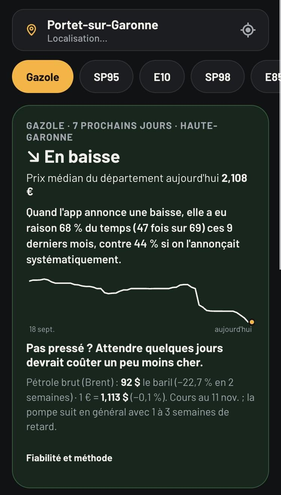

# Plein Malin

**Where and when to fill up in France — built on the official open fuel price data.**

Plein Malin turns France's real-time fuel price feed (~9,800 stations, published by the government every 10 minutes) into a mobile-first app: the cheapest stations around you, price history per station, and an honest 7-day trend for your département.

Live: **https://plein-malin.sukya-467.workers.dev** · 🇫🇷 [Version française](README.fr.md)

<p align="center"></p>

## Why

The French government publishes every station's prices as open data, for free, without an API key. But the raw feed is hard to use well:

- prices come as a JSON string that is sometimes an object, sometimes an array;
- timestamps are in Paris time even when suffixed `+00:00`;
- the feed has no station names or brands;
- stale prices, stock-outs, brand-capped prices and outliers sit next to fresh ones.

Plein Malin is an open reference implementation of the whole pipeline: **collect reliably, clean, store only what changes, and make forecasts that say when they don't know.**

## Features

| | |
|---|---|
| **7-day trend** | Median price of your département, expected direction (up / down / stable), Brent and EUR/USD context, and a plain recommendation (« fill up now » / « wait »). The reliability is **measured, not assumed**: when the model doesn't beat a naive baseline, the app shows « uncertain trend » and recommends nothing. |
| **Cheapest near me** | Map + the 5 cheapest stations within 3–20 km, with name/brand, gap to the local median, price freshness and a directions button. Queries the official feed live around your position (~0.2 s), falls back to the last collection only if the feed is down. |
| **Nationwide coverage** | All ~9,800 stations collected every 30 minutes, names from OpenStreetMap, 6 months of detailed history per station, daily medians since 2024, a forecast for each of the ~100 départements. |
| **Transparency** | Stock-outs flagged, prices unconfirmed for 7 days excluded and counted, abnormal prices marked « to check », brand-capped prices grouped (« same price in N TotalEnergies stations »), alert if prices haven't been refreshed for 2 hours. |
| **Station page** | All fuels, stock-outs, 30/90-day chart (one year of official history), comparison with neighbours, opening hours. |

## The forecast, honestly

- **What is announced**: only the **direction** at 7 days (up, down or stable), never an amount. Backtests show the model gets the direction right more often than the size of the move.
- **What the model looks at** (`src/lib/forecast.ts`, a linear regression): the daily median pump price of the département, the 7- and 14-day change of the wholesale refined product (diesel or gasoline, New York Harbor, EIA via FRED) converted to €/L with the ECB EUR/USD rate, recent pump dynamics, and the gap between the pump and its usual level given that wholesale price.
- **Training data**: about 4 years of daily medians rebuilt from the official yearly files (`npm run backfill:medians`), without keeping the detailed history.
- **Backtest**: every day of the last 9 months is replayed using only what was known on that date (wholesale prices, published ~4 days late, are shifted accordingly). Each kind of announcement is compared with the hit rate of making that same announcement **every day**.
- **Shown as reliable** only if the announcement has at least 65% hits, over at least 15 cases, and — for up or down — beats the systematic announcement by at least 10 points. Otherwise: « uncertain », no advice.
- **Measured direction accuracy** (up/down announcements, as of 18/10/2026): E10 and SP98 74%, SP95 68%, diesel 63% (currently shown as uncertain).

## Stack

Next.js 16 (App Router, TypeScript) · PostgreSQL (Neon) + Drizzle ORM · MapLibre GL + [OpenFreeMap](https://openfreemap.org) tiles (OpenStreetMap, no key) · Cloudflare Workers via [OpenNext](https://opennext.js.org/cloudflare) · collection in GitHub Actions.

Data sources, all public: [official real-time fuel prices](https://data.economie.gouv.fr/explore/dataset/prix-des-carburants-en-france-flux-instantane-v2/) and yearly history files, OpenStreetMap (station names), EIA via FRED (wholesale prices, Brent), ECB (EUR/USD).

## Getting started

Requirements: Node.js ≥ 20.9, Docker.

```bash
npm install            # also copies the MapLibre worker into public/vendor
cp .env.example .env
npm run db:up          # PostgreSQL 17 in Docker (port 5433)
npm run db:migrate     # create the tables
npm run collect        # first collection (~1 s)
npm run import:history # 6 months of history (official yearly file, ~3 min)
npm run enrich:osm     # names and brands from OpenStreetMap
npm run backfill:medians -- --from 2024-01-01   # département medians since 2024 (~5 min)
npm run sync:daily -- --days 365   # market prices, medians, forecasts
npm run verify         # check the database against the live official feed
npm run dev            # http://localhost:3000
```

Set `COLLECT_DEPARTEMENTS=31,81` in `.env` for a lighter local setup (default `all` = the whole country, ~9 MB per collection).

## API

- `GET /api/stations?lat=43.52&lon=1.40&radius=10&fuel=gazole` — stations in the radius sorted by price, with flags, stock-outs and the local median.
- `GET /api/forecast?fuel=gazole` — 7-day forecast and backtest results.
- `GET /api/stations/:id/history?days=90` — price changes of a station.

Fuels: `gazole`, `sp95`, `e10`, `sp98`, `e85`, `gplc`.

## How it runs

- **Collection** (`.github/workflows/collect.yml`): every 30 minutes during the day, a self-contained bundle (`jobs/collector.mjs`, built by `npm run build:job`) fetches the national feed and stores only **price changes**; a daily task cleans old data, syncs market prices, rebuilds medians and forecasts.
- **Storage** is kept within Neon's free plan: only changes are stored, history is pruned, the database sleeps between collections.
- **Web**: a Cloudflare Worker serves the app; queries go through Hyperdrive.
- **Audience stats** (`/stats`, password-protected) count unique visitors without storing IP addresses (daily salted hash), respect Do Not Track / GPC and keep data 13 months.

The [French README](README.fr.md) documents the feed's quirks, the data model, the free-plan budget and the deployment in detail.

## Scripts

| Script | |
|---|---|
| `dev` / `build` / `start` | Next.js |
| `test` | Unit tests (Vitest): forecast, market data, time zones, API, audience stats |
| `typecheck` / `lint` | TypeScript / ESLint |
| `db:up` · `db:migrate` · `db:generate` · `db:studio` | Database |
| `collect` · `collect:watch` | Collector |
| `import:history` · `backfill:medians` | Official history |
| `enrich:osm` | Station names and brands (OpenStreetMap) |
| `sync:daily` | Market prices, daily medians, forecasts |
| `verify` | Consistency check against the live feed (exit code 1 on mismatch) |
| `cf:build` · `cf:preview` · `cf:deploy` | Cloudflare |

## Roadmap

- Extract the collector and data-quality rules into a reusable package.
- A documented open API for the cleaned data.
- Per-station habits (which day prices change, how fast a station follows rises and falls).
- « Is the detour worth it? » (consumption, litres, round trip).

## Contributing

Issues and pull requests are welcome: data-quality rules, forecast improvements, translations, accessibility. Please run `npm test`, `npm run typecheck` and `npm run lint` before opening a PR.

## License

[MIT](LICENSE). Fuel price data: French government open data (Licence Ouverte / Etalab). Map data © OpenStreetMap contributors.
